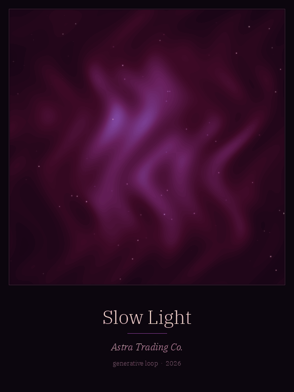

# Slow Light — a Generative Art Card

600x800 portrait GIF, 60 frames at 60 ms (3.6 s), seamless loop, ~3.8 MB. Title and artist plate only, no logos.

## Process note
Slow Light is a breathing nebula in deep burgundy and violet. The cloud is a sum of fourteen random sine waves, gently domain-warped, mapped through a night-to-rose-gold colour ramp; a soft glowing core swells and settles once per loop like a slow breath, and 140 faint stars twinkle on their own rhythms. Every moving term is a sine of the loop phase with a whole-number frequency, so the last frame flows straight into the first with no seam. All frames share one 256-colour palette, which avoids flicker and keeps the file under 5 MB.

## Run
    pip install numpy pillow
    python slow_light.py   # writes slow_light.gif (seeded, reproducible)

Made by Astra Trading Co. Code MIT licensed.
